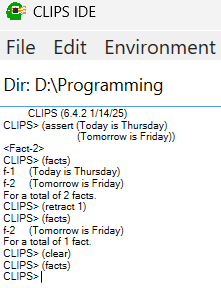
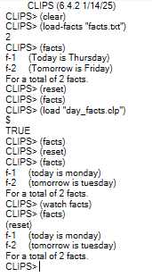
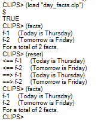
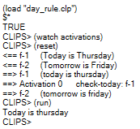
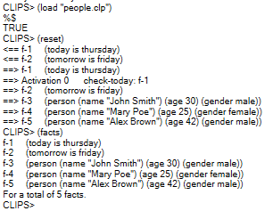
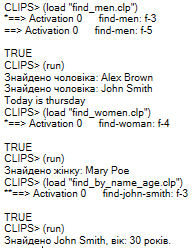

**Лабораторна робота №1**

**Постановка задачі**

1.	Провести виконання та відлагодження програми в командному вікні.
2.	Зберегти програму.
3.	Сформувати та надіслати на перевірку оформлений звіт.

**Хід роботи**

**Завдання 1.** Операції з фактами `assert`, `retract`, `facts`, `reset`.
Вводжу наступні факти в базу фактів:
```
(Today is Thursday)
(Tomorrow is Friday)
```
Далі перевіряю наявність фактів, після чого видаляю перший факт, перевіряю факти знову та видаляю всі факти командою `clear` (рис. 1).
 


Рис. 1 

**Завдання 2.** Формування бази фактів за допомогою списку фактів; `deffacts`, `clear`, `watch`.
Завантажую факти за допомогою команди `load-facts`, вказуючи назву файла з фактами. Перевіряю факти та очищаю базу фактів (рис. 2). 



Рис. 2

Далі завантажую правила за допомогою команди `load`, вказуючи назву файлу. Також, відображаються зміни в базі фактів, оскільки було виконано команду `watch facts`. 



Рис. 3

**Завдання 3.** Прості правила; `defrule`, `variables`, `printout`, `run`, `refresh`.
Створюю новий файл `day_rule.clp` з наступним змістом:
```
(deffacts what-day-is-it?
   (today is thursday)
   (tomorrow is friday)
)

(defrule check-today
   (today is ?day)
   =>
   (printout t "Today is " ?day crlf)
)
```
Далі завантажую правила використовуючи `load`. Щоб відслідковувати активацію правил, використовую команду `watch activations`. Наприкінці запускаю виконання по заданим правилам використовуючи `run`.



Рис. 4

**Завдання 4.** Впорядковані факти; `deftemplate`, `slots`.
Створюю новий файл `people.clp` з наступним змістом:
```
(deftemplate person
   (slot name)
   (slot age)
   (slot gender)
)

(deffacts people
   (person (name "John Smith") (age 30) (gender male))
   (person (name "Mary Poe") (age 25) (gender female))
   (person (name "Alex Brown") (age 42) (gender male))
)
```
Завантажую вказаний файл та перезавантажую базу фактів командою `reset`.



Рис. 5

**Завдання 5.** Правила для пошуку.
Створюю три файли та визначаю правила для пошуку людей за певними характеристиками:
Файл `find_men`:
```
(defrule find-men
   (person (name ?name) (gender male))
   =>
   (printout t "Знайдено чоловіка: " ?name crlf)
)
```
Файл `find_women`:
```
(defrule find-woman
   (person (name ?name) (gender female))
   =>
   (printout t "Знайдено жінку: " ?name crlf)
)
```
Файл `find_by_name_age`:
```
(defrule find-by-age-25
   (person (name $name) (age 25))
   =>
   (printout t "Людині " $name " виповнилося 25 років." crlf)
)

(defrule find-john-smith
   (person (name "John Smith") (age ?age))
   =>
   (printout t "Знайдено John Smith, вік: " ?age " років." crlf)
)
```
Далі завантажую правила та почергово виконую їх:
 


Рис. 6

**Висновки:** в ході виконання роботи ознайомився з командами для операцій над правилами, шаблонами, змінними, командами для завантаження правил визначених в файлах, командами для реініціалізації бази фактів та командами виводу.
