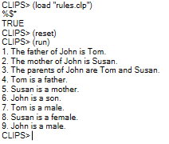
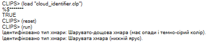

### Лабораторна робота №3

**Варіант 3**

**Завдання 1.** Для реалізації цього завдання виключно за допомогою правил та початкових фактів використаємо патерн керування послідовністю (через лічильник кроків), який забезпечить вивід усіх 9 речень у суворо визначеному порядку під час виконання команди `(run)`.

**Код програми:**
```
;; 1. Визначення шаблону для фактів про родину
(deftemplate family-fact
   (slot id)
   (slot text)
)

;; 2. Початкові факти
(deffacts initial-family-facts
   (current-step 1)
   (family-fact (id 1) (text "1. The father of John is Tom."))
   (family-fact (id 2) (text "2. The mother of John is Susan."))
   (family-fact (id 3) (text "3. The parents of John are Tom and Susan."))
   (family-fact (id 4) (text "4. Tom is a father."))
   (family-fact (id 5) (text "5. Susan is a mother."))
   (family-fact (id 6) (text "6. John is a son."))
   (family-fact (id 7) (text "7. Tom is a male."))
   (family-fact (id 8) (text "8. Susan is a female."))
   (family-fact (id 9) (text "9. John is a male."))
)

;; 3. Правило для послідовного виведення фактів на екран
(defrule process-family-facts
   ;; Знаходимо поточний крок
   ?step-fact <- (current-step ?n)
   ;; Знаходимо факт, який відповідає цьому кроку
   ?fact <- (family-fact (id ?n) (text ?txt))
   =>
   ;; Виводимо текст у консоль
   (printout t ?txt crlf)
   ;; Видаляємо опрацьований факт та поточний крок
   (retract ?fact)
   (retract ?step-fact)
   ;; Переходимо до наступного кроку (якщо він є в межах від 1 до 9)
   (bind ?next (+ ?n 1))
   (if (<= ?next 9)
      then (assert (current-step ?next))
   )
)
```



Рис. 1

**Завдання 2.** Описуємо хмару за трьома основними атрибутами: висотою (категорією ярусу), зовнішнім виглядом (форми) та наявністю опадів/кольору. Зіставляємо комбінації цих атрибутів відповідно до наданих описів. Завантажуємо файл та запускаємо команди `(reset)` і `(run)`.

**Код програми:**
```
;; 1. Шаблон для опису вхідних атрибутів хмари
 (deftemplate cloud-attributes
   (slot height-category)   ;; категорія висоти: low (<=1800), medium (1800-6000), high (>6000), variable (від нижнього до верхнього)
   (slot appearance)        ;; вигляд: heaps (округлені купи), sheets (гладкі листи), wispy (пучки волосся)
   (slot precipitation)     ;; опади/колір: yes-dark (мають опади і темно-сірий колір), none (немає)
)

;; 2. Приклади вхідних фактів для ідентифікації
(deffacts input-clouds
   ;; Приклад 1: Хмара нижнього ярусу, рівні листи
   (cloud-attributes (height-category low) (appearance sheets) (precipitation none))
   
   ;; Приклад 2: Хмара з опадами та темно-сірим кольором
   (cloud-attributes (height-category medium) (appearance sheets) (precipitation yes-dark))
)

;; 3. Правила ідентифікації типів хмар

;; Правило для шаруватих хмар (нижній ярус, гладкі листи)
(defrule identify-stratus
   (cloud-attributes (height-category low) (appearance sheets) (precipitation none))
   =>
   (printout t "Ідентифіковано тип хмари: Шарувата хмара (нижній ярус)." crlf)
)

;; Правило для шарувато-купчастих хмар (нижній ярус / або верхній ярус залежно від контексту тексту)
(defrule identify-stratocumulus-low
   (cloud-attributes (height-category low) (appearance heaps) (precipitation none))
   =>
   (printout t "Ідентифіковано тип хмари: Шарувато-купчаста хмара (нижній ярус)." crlf)
)

;; Правило для високо-шаруватих хмар (середній ярус, гладкі листи)
(defrule identify-altostratus
   (cloud-attributes (height-category medium) (appearance sheets) (precipitation none))
   =>
   (printout t "Ідентифіковано тип хмари: Високо-шарувата хмара (середній ярус)." crlf)
)

;; Правило для шарувато-дощових хмар (середній/нижній ярус, листи, опади і темно-сірий колір)
(defrule identify-nimbostratus
   (cloud-attributes (height-category medium) (appearance sheets) (precipitation yes-dark))
   =>
   (printout t "Ідентифіковано тип хмари: Шарувато-дощова хмара (має опади і темно-сірий колір)." crlf)
)

;; Правило для перистих хмар (верхній ярус, пучки волосся)
(defrule identify-cirrus
   (cloud-attributes (height-category high) (appearance wispy) (precipitation none))
   =>
   (printout t "Ідентифіковано тип хмари: Периста хмара (верхній ярус)." crlf)
)

;; Правило для перисто-шаруватих хмар (верхній ярус)
(defrule identify-cirrostratus
   (cloud-attributes (height-category high) (appearance sheets) (precipitation none))
   =>
   (printout t "Ідентифіковано тип хмари: Перисто-шарувата хмара (верхній ярус)." crlf)
)

;; Правило для купчастих та купчасто-дощових хмар (від нижнього до верхнього ярусу, великі купи)
(defrule identify-cumulus-or-cumulonimbus
   (cloud-attributes (height-category variable) (appearance heaps) (precipitation ?precip))
   =>
   (if (eq ?precip yes-dark)
      then (printout t "Ідентифіковано тип хмари: Купчасто-дощова хмара (має опади і темно-сірий колір, сягає від нижнього до верхнього ярусу)." crlf)
      else (printout t "Ідентифіковано тип хмари: Купчаста хмара (сягає від нижнього до верхнього ярусу)." crlf)
   )
)
```


Рис. 2

