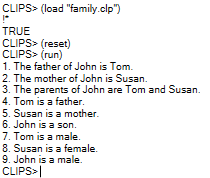
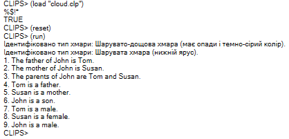

### Лабораторна робота №4

**Варіант 3**

**Завдання 1.** У цьому завданні логіку друку виносимо в окрему функцію `print-family-sentences`, яка викликається правилом при запуску системи.

**Код програми:**
```
(deffunction print-family-sentences ()
   (printout t "1. The father of John is Tom." crlf)
   (printout t "2. The mother of John is Susan." crlf)
   (printout t "3. The parents of John are Tom and Susan." crlf)
   (printout t "4. Tom is a father." crlf)
   (printout t "5. Susan is a mother." crlf)
   (printout t "6. John is a son." crlf)
   (printout t "7. Tom is a male." crlf)
   (printout t "8. Susan is a female." crlf)
   (printout t "9. John is a male." crlf)
)

(defrule trigger-family-print
   =>
   (print-family-sentences)
)
```
**Результат:**



Рис. 1

**Завдання 2.** В цьому завданні логіку визначення типу хмари інкапсулюємо у функцію `identify-cloud-func`, яка приймає параметри атрибутів хмари та виконує розгалуження за допомогою умовних операторів `if-else`. Правило збирає факти з бази та передає їх у функцію.

**Код програми:**
```
;; 1. Шаблон для опису вхідних атрибутів хмари
(deftemplate cloud-attributes
   (slot height-category)   ;; категорія висоти: low, medium, high, variable
   (slot appearance)        ;; вигляд: sheets, heaps, wispy
   (slot precipitation)     ;; опади/колір: yes-dark, none
)

;; 2. Приклади вхідних фактів
(deffacts input-clouds
   (cloud-attributes (height-category low) (appearance sheets) (precipitation none))
   (cloud-attributes (height-category medium) (appearance sheets) (precipitation yes-dark))
)

;; 3. Функція ідентифікації типу хмари за переданими параметрами
(deffunction identify-cloud-func (?height ?appearance ?precip)
   (if (and (eq ?height low) (eq ?appearance sheets) (eq ?precip none))
      then (printout t "Ідентифіковано тип хмари: Шарувата хмара (нижній ярус)." crlf)
   else (if (and (eq ?height low) (eq ?appearance heaps) (eq ?precip none))
      then (printout t "Ідентифіковано тип хмари: Шарувато-купчаста хмара (нижній ярус)." crlf)
   else (if (and (eq ?height medium) (eq ?appearance sheets) (eq ?precip none))
      then (printout t "Ідентифіковано тип хмари: Високо-шарувата хмара (середній ярус)." crlf)
   else (if (and (eq ?height medium) (eq ?appearance sheets) (eq ?precip yes-dark))
      then (printout t "Ідентифіковано тип хмари: Шарувато-дощова хмара (має опади і темно-сірий колір)." crlf)
   else (if (and (eq ?height high) (eq ?appearance wispy) (eq ?precip none))
      then (printout t "Ідентифіковано тип хмари: Периста хмара (верхній ярус)." crlf)
   else (if (and (eq ?height high) (eq ?appearance sheets) (eq ?precip none))
      then (printout t "Ідентифіковано тип хмари: Перисто-шарувата хмара (верхній ярус)." crlf)
   else (if (eq ?height variable)
      then (if (eq ?precip yes-dark)
         then (printout t "Ідентифіковано тип хмари: Купчасто-дощова хмара (має опади і темно-сірий колір, сягає від нижнього до верхнього ярусу)." crlf)
         else (printout t "Ідентифіковано тип хмари: Купчаста хмара (сягає від нижнього до верхнього ярусу)." crlf)
      )
      else (printout t "Не вдалося ідентифікувати тип хмари за заданими параметрами." crlf)
   )))))))
)

;; 4. Правило, що зв'язує базу фактів із функцією
(defrule process-clouds
   (cloud-attributes (height-category ?h) (appearance ?a) (precipitation ?p))
   =>
   ;; Виклик функції із передачею значень зі слотів факту
   (identify-cloud-func ?h ?a ?p)
)
```
**Результат:**



Рис. 2
