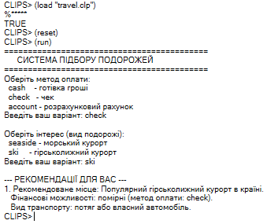

### Лабораторна робота №5

**Варіант 3**

**Завдання 1.** Перетворіть наведені нижче інфіксні вираження в префіксні вираження.
```
а) (3 + 4) * (5 + 6) + 7; 
б) (5 * (5 + 6 + 7)) - ((3 * (4/9) + 2) / 8); 
в) 6 - 9 * 8/3 + 4 - (8 - 2 - 3) * 6/7.
```
**Рішення:**
```
а) (+ (* (+ 3 4) (+ 5 6)) 7)
б) (- (* 5 (+ (+ 5 6) 7)) (/ (+ (* 3 (/ 4 9)) 2) 8)) 
в) (- (+ (- 6 (/ (* 9 8) 3)) 4) (/ (* (- (- 8 2) 3) 6) 7))
```
**Завдання 2.** Розробіть програму CLIPS на основі правил IF-THEN, складених під час вирішення завдання 3.5, представленої на стор. 289. Програма повинна задавати питання про те, який метод оплати кращий для мандрівника і яка подорож його цікавить, після чого пропонувати можливі поїздки з урахуванням відповідей на ці два питання.

**Код програми:**
```
;; Програма вибору подорожі

;; 1. Шаблон для збереження преференцій користувача
(deftemplate traveler-preferences
   (slot payment-method)   ;; cash (готівка), check (чек), account (рахунок)
   (slot vacation-type)    ;; seaside (морський), ski (гірськолижний)
)

;; 2. Інтерактивне правило для опитування користувача
(defrule ask-preferences
   (declare (salience 10))
   (not (traveler-preferences))
   =>
   (printout t "===========================================" crlf)
   (printout t "      СИСТЕМА ПІДБОРУ ПОДОРОЖЕЙ            " crlf)
   (printout t "===========================================" crlf)
   
   ;; Запит методу оплати (cash, check, account)
   (printout t "Оберіть метод оплати:" crlf)
   (printout t "  cash    - готівка гроші" crlf)
   (printout t "  check   - чек" crlf)
   (printout t "  account - розрахунковий рахунок" crlf)
   (printout t "Введіть ваш варіант: ")
   (bind ?pay (read))
   
   ;; Запит різновиду місця відпочинку (seaside, ski)
   (printout t crlf "Оберіть інтерес (вид подорожі):" crlf)
   (printout t "  seaside - морський курорт" crlf)
   (printout t "  ski     - гірськолижний курорт" crlf)
   (printout t "Введіть ваш варіант: ")
   (bind ?vac (read))
   
   ;; Зберігаємо вибір у базу фактів
   (assert (traveler-preferences (payment-method ?pay) (vacation-type ?vac)))
   (printout t crlf "--- РЕКОМЕНДАЦІЇ ДЛЯ ВАС ---" crlf)
)

;; Правила IF-THEN для 4 можливих напрямків

;; Напрямок 1: Бюджетний морський відпочинок (готівка)
(defrule recommend-budget-seaside
   (traveler-preferences (payment-method cash) (vacation-type seaside))
   =>
   (printout t "1. Рекомендоване місце: Бюджетний морський курорт (регіональне узбережжя)." crlf)
   (printout t "   Фінансові можливості: готівковий розрахунок." crlf)
   (printout t "   Вид транспорту: автобус або залізничний транспорт." crlf)
)

;; Напрямок 2: Елітний морський відпочинок (чек або розрахунковий рахунок)
(defrule recommend-luxury-seaside
   (traveler-preferences (payment-method ?m&:(or (eq ?m check) (eq ?m account))) (vacation-type seaside))
   =>
   (printout t "1. Рекомендоване місце: Елітний тропічний морський курорт (острови)." crlf)
   (printout t "   Фінансові можливості: високі (метод оплати: " ?m ")." crlf)
   (printout t "   Вид транспорту: пасажирський літак." crlf)
)

;; Напрямок 3: Стандартний гірськолижний курорт (готівка або чек)
(defrule recommend-standard-ski
   (traveler-preferences (payment-method ?m&:(or (eq ?m cash) (eq ?m check))) (vacation-type ski))
   =>
   (printout t "1. Рекомендоване місце: Популярний гірськолижний курорт в країні." crlf)
   (printout t "   Фінансові можливості: помірні (метод оплати: " ?m ")." crlf)
   (printout t "   Вид транспорту: потяг або власний автомобіль." crlf)
)

;; Напрямок 4: Преміум гірськолижний курорт (розрахунковий рахунок)
(defrule recommend-premium-ski
   (traveler-preferences (payment-method account) (vacation-type ski))
   =>
   (printout t "1. Рекомендоване місце: Преміальний альпійський курорт (Європа)." crlf)
   (printout t "   Фінансові можливості: високі (розрахунковий рахунок)." crlf)
   (printout t "   Вид транспорту: літак із приватним трансфером." crlf)
)
```
**Результат:**



Рис. 1
